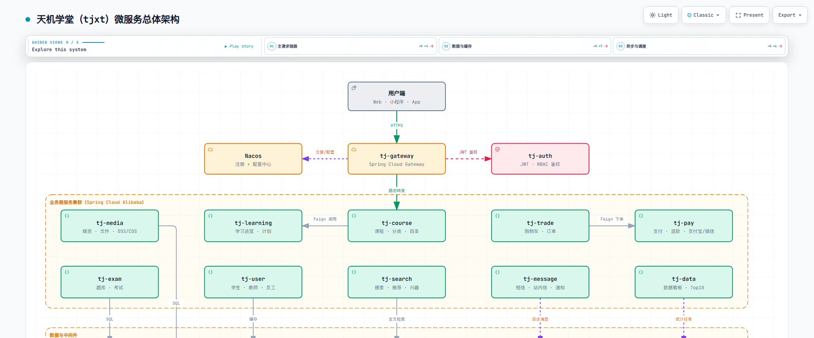

<div align="center">

# 天机学堂 · Tianji Xuetang

**基于 Spring Cloud Alibaba 的在线教育平台微服务实践**

Java 11 · Spring Boot 2.7 · Spring Cloud Alibaba 2021 · Nacos · Gateway · MyBatis-Plus · MySQL · Redis · MongoDB · Elasticsearch · RabbitMQ

</div>

---

> **仓库说明**
>
> 为保护账号与隐私安全，本仓库中的内网地址、Nacos 命名空间、云服务 AK/SK、支付商户号与私钥、证书库密码等敏感信息均已用 `*` 脱敏，`tjxt.jks` 证书库文件也未包含在仓库中。
> 直接克隆后需要先按下文「配置与脱敏说明」补全自己的本地配置，项目才能正常启动。

## 一、项目简介

天机学堂是一套面向职业技能培训场景的在线教育平台后端系统，采用 Spring Cloud Alibaba 微服务架构，按业务域拆分为 14 个可运行服务、16 个 Maven 模块，覆盖「课程内容 → 学习过程 → 考试评测 → 交易支付 → 营销促销 → 互动消息 → 数据运营」的完整业务闭环。

本仓库在课程案例的基础上，完成了学习中心、考试中心、积分体系、优惠券/兑换码、点赞评价等模块的接口实现与联调，并整理了架构图、OpenAPI 接口文档与数据库脚本，适合作为微服务架构、分布式缓存、消息驱动等技术的实践参考。

- **16** 个 Maven 模块，**14** 个可运行微服务
- **200+** REST 接口（Apifox / OpenAPI 3.0 文档）
- **13** 个 MySQL 业务库 + MongoDB + Elasticsearch
- 统一网关鉴权、统一响应与异常、Feign 服务调用、RabbitMQ 异步解耦

## 二、功能模块

| 分层 | 模块 | 主要职责 |
| --- | --- | --- |
| 基础 | `tj-common` | 通用配置、统一响应 `R<T>` / `PageDTO`、全局异常、工具类、MyBatis-Plus 自动填充、Redisson / RabbitMQ / XXL-Job 自动装配 |
| 基础 | `tj-api` | 服务间 Feign 客户端、DTO 契约与常量 |
| 接入 | `tj-gateway` | Spring Cloud Gateway 路由、JWT 鉴权过滤器、Knife4j 文档聚合（端口 10010） |
| 权限 | `tj-auth` | 登录、JWT 签发与校验、RBAC 权限；含 `tj-auth-common`、`tj-auth-gateway-sdk`、`tj-auth-resource-sdk`、`tj-auth-service` 四个子模块 |
| 用户 | `tj-user` | 学生、教师、员工、角色与账号管理 |
| 内容 | `tj-course` | 课程、章节、目录、分类、师资、上下架与草稿 |
| 内容 | `tj-media` | 图片/视频上传、腾讯云 COS 对象存储与 VOD 点播 |
| 内容 | `tj-search` | 基于 Elasticsearch 的课程检索与推荐 |
| 学习 | `tj-learning` | 我的课表、学习记录与进度、笔记、签到、积分与排行榜、互动问答 |
| 学习 | `tj-exam` | 题库、题目、考试、答卷提交与自动判分（考试记录存 MongoDB） |
| 交易 | `tj-trade` | 购物车、订单、订单明细、退款申请 |
| 交易 | `tj-pay` | 支付宝 / 微信支付、支付回调、退款 |
| 交易 | `tj-promotion` | 优惠券模板、使用范围、发放、领取、兑换码与折扣计算 |
| 运营 | `tj-message` | 站内信、通知、阿里云短信 |
| 运营 | `tj-remark` | 点赞、评价互动 |
| 运营 | `tj-data` | 数据看板与 TopN 统计 |

> 各服务默认端口见对应模块的 `src/main/resources/bootstrap.yml`：网关 `10010`，业务服务分布在 `8081 ~ 8093`。

## 三、技术栈

| 分类 | 技术选型 |
| --- | --- |
| 语言与构建 | Java 11、Maven 多模块 |
| 基础框架 | Spring Boot 2.7.2、Spring Cloud 2021.0.3、Spring Cloud Alibaba 2021.0.1.0 |
| 注册与配置 | Nacos（服务发现 + 配置中心，共享配置） |
| 网关与鉴权 | Spring Cloud Gateway、JWT（RSA）、RBAC、自定义 Auth SDK |
| 服务调用 | OpenFeign、Spring Cloud LoadBalancer |
| 数据访问 | MyBatis-Plus 3.4.3、MySQL 8.0、MongoDB（考试记录） |
| 缓存 | Redis、Redisson（分布式锁） |
| 搜索 | Elasticsearch 7.12（RestHighLevelClient） |
| 消息 | RabbitMQ |
| 分布式事务 | Seata 1.5.1 |
| 任务调度 | XXL-Job 2.3.1 |
| 接口文档 | Knife4j 3.0.3、OpenAPI 3.0 |
| 第三方服务 | 阿里云短信、腾讯云 COS / VOD、支付宝、微信支付 v3 |
| 构建部署 | Docker、Shell（`Dockerfile`、`startup.sh`） |

## 四、系统架构



- **接入层**：客户端流量统一进入 `tj-gateway`，由网关完成路由转发与 JWT 鉴权，并聚合各服务的 Knife4j 文档。
- **鉴权**：`tj-auth` 负责登录、Token 签发与 RBAC 权限校验；网关与业务服务分别通过 `tj-auth-gateway-sdk`、`tj-auth-resource-sdk` 接入。
- **服务间调用**：同步调用走 OpenFeign，接口契约集中在 `tj-api`，配合 LoadBalancer 做客户端负载均衡。
- **数据与异步**：MySQL 存业务数据，Redis 做缓存 / 排行榜 / 分布式锁，MongoDB 存考试记录，Elasticsearch 承担课程检索，RabbitMQ 负责异步解耦，XXL-Job 执行定时统计与对账。

更多可交互架构图与流程图：

- [总体架构（可交互）](docs/diagrams/tjxt-architecture.html)
- [鉴权流程](docs/diagrams/tjxt-auth-workflow.html)
- [下单支付时序](docs/diagrams/tjxt-order-pay-sequence.html)

## 五、目录结构

```text
tianji
├── tj-common                 # 公共模块：统一响应、异常、工具、自动装配
├── tj-api                    # Feign 客户端与 DTO 契约
├── tj-auth                   # 认证授权
│   ├── tj-auth-common        #   通用常量与工具
│   ├── tj-auth-gateway-sdk   #   网关侧鉴权 SDK
│   ├── tj-auth-resource-sdk  #   业务服务侧鉴权 SDK
│   └── tj-auth-service       #   认证服务（8081）
├── tj-gateway                # 网关（10010）
├── tj-user                   # 用户中心（8082）
├── tj-search                 # 搜索服务（8083）
├── tj-media                  # 媒资中心（8084）
├── tj-message                # 消息中心（8085）
├── tj-course                 # 课程中心（8086）
├── tj-pay                    # 支付中心（8087）
├── tj-trade                  # 交易中心（8088）
├── tj-exam                   # 考试中心（8089）
├── tj-learning               # 学习中心（8090）
├── tj-remark                 # 评价中心（8092）
├── tj-promotion              # 营销中心（8092）
├── tj-data                   # 数据中心（8093）
├── docs
│   ├── diagrams              # 架构图、鉴权流程、支付时序（HTML / PNG）
│   └── sql                   # 权限菜单、课程分类、笔记、XXL-Job 初始化脚本
├── apifox                    # OpenAPI 3.0 接口文档
├── Dockerfile
├── startup.sh
└── pom.xml
```

## 六、核心业务实现

### 学习中心

- **我的课表**：按天聚合课程与章节，返回每日学习计划。
- **学习记录**：上报学习进度与时长，通过 RabbitMQ 异步发送事件，驱动积分与统计更新。
- **笔记**：学生端笔记的增删改查，管理端分页查看与隐藏。
- **签到与积分**：签到记录、积分明细、积分排行榜与赛季榜（Redis ZSet 实现）。
- **互动问答**：提问、回答、评论及管理端审核。

### 考试中心

- 题库与题目管理，支持按课程、题目类型维护。
- 创建考试、抽取题目、提交答卷并自动判分（客观题），同时更新题目统计。
- 考试记录与答题明细存入 MongoDB，支持分页查询成绩。

### 营销与交易

- 优惠券模板、使用范围（分类 / 课程）、发放与领取、兑换码兑换。
- 多种折扣类型与优惠计算，支撑下单时的优惠试算。
- 购物车、订单、订单明细、支付单、退款申请与审核。
- 支付宝、微信支付 v3 的下单、回调验签、退款与对账。

### 平台能力

- 网关统一 JWT 鉴权 + RBAC 权限控制，权限数据缓存于 Redis。
- 统一响应包装 `R<T>`、分页 `PageDTO`、全局异常处理与参数校验。
- MyBatis-Plus 字段自动填充（创建时间、更新时间等）。
- Redisson 分布式锁、RabbitMQ 消息重试、XXL-Job 定时任务。
- Seata 处理跨服务事务（课程、考试等场景）。

## 七、快速开始

### 1. 环境要求

| 组件 | 版本 / 说明 |
| --- | --- |
| JDK | 11 |
| Maven | 3.8+ |
| MySQL | 8.0+ |
| Redis | 6.0+ |
| MongoDB | 4.0+（考试记录） |
| Nacos | 2.x（注册与配置中心） |
| RabbitMQ | 3.9+ |
| Elasticsearch | 7.12（搜索服务需要） |
| XXL-Job | 2.3.1（定时任务，可选） |
| Seata | 1.5.1（分布式事务，可选） |

### 2. 克隆项目

```bash
git clone https://github.com/Tian-917/tianji.git
cd tianji
```

### 3. 初始化 Nacos

1. 启动 Nacos，新建命名空间（例如 `tianji-dev`）。
2. 在命名空间内创建共享配置（Group 使用 `DEFAULT_GROUP`）：
   `shared-spring.yaml`、`shared-redis.yaml`、`shared-mybatis.yaml`、`shared-logs.yaml`、`shared-feign.yaml`、`shared-mq.yaml`、`shared-xxljob.yaml`。
3. 为每个服务创建 `<spring.application.name>-dev.yaml`，例如 `course-service-dev.yaml`、`learning-service-dev.yaml`，至少配置：
   - MySQL 数据源（url、username、password）
   - Redis 地址与密码
   - RabbitMQ 地址、账号、vhost
   - MongoDB 连接（考试服务）
   - Elasticsearch 地址（搜索服务）
   - XXL-Job 管理端地址与执行器配置（可选）
4. 把 Nacos 地址与命名空间填写到各服务的 `bootstrap-dev.yml` 中（当前为脱敏占位符）。

### 4. 初始化数据库

创建 13 个业务库：

```sql
CREATE DATABASE tj_auth      DEFAULT CHARACTER SET utf8mb4;
CREATE DATABASE tj_user      DEFAULT CHARACTER SET utf8mb4;
CREATE DATABASE tj_course    DEFAULT CHARACTER SET utf8mb4;
CREATE DATABASE tj_media     DEFAULT CHARACTER SET utf8mb4;
CREATE DATABASE tj_search    DEFAULT CHARACTER SET utf8mb4;
CREATE DATABASE tj_learning  DEFAULT CHARACTER SET utf8mb4;
CREATE DATABASE tj_trade     DEFAULT CHARACTER SET utf8mb4;
CREATE DATABASE tj_pay       DEFAULT CHARACTER SET utf8mb4;
CREATE DATABASE tj_exam      DEFAULT CHARACTER SET utf8mb4;
CREATE DATABASE tj_message   DEFAULT CHARACTER SET utf8mb4;
CREATE DATABASE tj_data      DEFAULT CHARACTER SET utf8mb4;
CREATE DATABASE tj_remark    DEFAULT CHARACTER SET utf8mb4;
CREATE DATABASE tj_promotion DEFAULT CHARACTER SET utf8mb4;
```

`docs/sql/` 下提供了权限菜单、课程分类、笔记、XXL-Job 等补充脚本，按文件头注释在对应库中执行。考试记录所需的 MongoDB 库为 `tj_exam`。

### 5. 生成鉴权证书库

`tj-auth` 启动依赖 `tjxt.jks`，该文件未随仓库提供，请自行生成：

```bash
keytool -genkeypair -alias tjxt -keyalg RSA -keysize 2048 -validity 3650 \
  -keystore tjxt.jks -storepass '<your-password>' \
  -dname "CN=tianji, OU=dev, O=tianji, L=Shanghai, ST=Shanghai, C=CN"
```

将生成的 `tjxt.jks` 放到 `tj-auth/tj-auth-service/src/main/resources/`，并把密码写入 `tj-auth/tj-auth-service/src/main/resources/bootstrap.yml`：

```yaml
encrypt:
  key-store:
    alias: tjxt
    location: classpath:tjxt.jks
    password: "******"
    secret: "******"
```

### 6. 编译与启动

```bash
mvn clean install -DskipTests
```

按「Nacos → MySQL / Redis / MongoDB / RabbitMQ / Elasticsearch → 各业务服务 → 网关」的顺序启动各模块的 `*Application` 启动类，或在 IDE 中直接运行。

启动完成后访问：

- 网关聚合文档：<http://localhost:10010/doc.html>
- 单个服务文档：`http://localhost:<服务端口>/doc.html`

> **端口提示**：`remark-service` 与 `promotion-service` 默认端口都是 `8092`，如需同时启动，请修改其中一个服务的 `server.port` 或通过 Nacos 配置覆盖。

## 八、配置与脱敏说明

公开仓库不包含任何可用的真实凭证。具体处理如下：

| 位置 | 脱敏内容 | 处理方式 |
| --- | --- | --- |
| `tj-*/src/main/resources/bootstrap-dev.yml`、`bootstrap-local.yml` | Nacos 地址、注册 IP、Elasticsearch 地址、命名空间 | 替换为 `***.***.***.***` / `********-****-...` |
| `tj-auth/.../bootstrap.yml` | 证书库密码、密钥 | `******` |
| `tj-media/.../bootstrap.yml` | 腾讯云 `appId`、`secretId`、`secretKey`、`urlKey`、`bucket` | 全部用 `*` 代替 |
| `tj-message/.../bootstrap.yml` | 阿里云短信 `accessId`、`accessSecret` | 全部用 `*` 代替 |
| `tj-pay/.../bootstrap.yml` | 支付宝 / 微信 `appId`、商户号、私钥、公钥、`apiV3Key`、回调域名 | 全部用 `*` 代替 |
| `tj-pay/.../AliPayTest.java` | 测试类中的支付宝应用与密钥 | 替换为 `***` |
| `tj-common/.../spring-configuration-metadata.json` | 默认主机、账号、密码 | 替换为 `*`（仅 IDE 提示，不影响运行） |
| `tj-auth/.../tjxt.jks`、`tjxt.jks` | 证书库文件 | 已从仓库移除，需自行生成 |

安全建议：

- 不要将真实密钥、证书、内网地址提交到公开仓库；本地开发建议使用环境变量或 Nacos 配置中心管理。
- 支付、短信、对象存储等功能需要自行申请账号并填入配置，仓库中不包含任何有效凭证。
- 如果不使用上述第三方能力，可在配置中关闭对应功能的 `enable` 开关，避免启动时校验失败。

## 九、常见问题

**Q：启动时报 “Nacos config not found”？**
检查 Nacos 中是否存在 `shared-*.yaml` 以及 `<spring.application.name>-dev.yaml`，并确认 `spring.profiles.active` 与命名空间配置正确。

**Q：数据库连接失败？**
数据源配置位于 Nacos 的共享/服务配置中，确认 MySQL 地址、账号、密码及 13 个业务库已创建。

**Q：认证服务启动失败，提示 keystore 相关错误？**
确认 `tjxt.jks` 已放到 `tj-auth/tj-auth-service/src/main/resources/`，且 `password`、`secret` 与生成证书库时设置的密码一致。

**Q：搜索功能不可用？**
`tj-search` 依赖 Elasticsearch 7.12，需先启动 ES 并配置 `spring.elasticsearch.uris`。

## 十、致谢与声明

- 本项目基于「天机学堂」课程案例进行学习、实现与整理，感谢原作者及传智教育研究院的课程内容。
- 仓库中的架构图、接口文档与数据库脚本仅用于学习交流，不保证生产环境可用。
- 第三方云服务、支付渠道的账号与密钥请自行申请并妥善保管，仓库不包含任何有效凭证。
